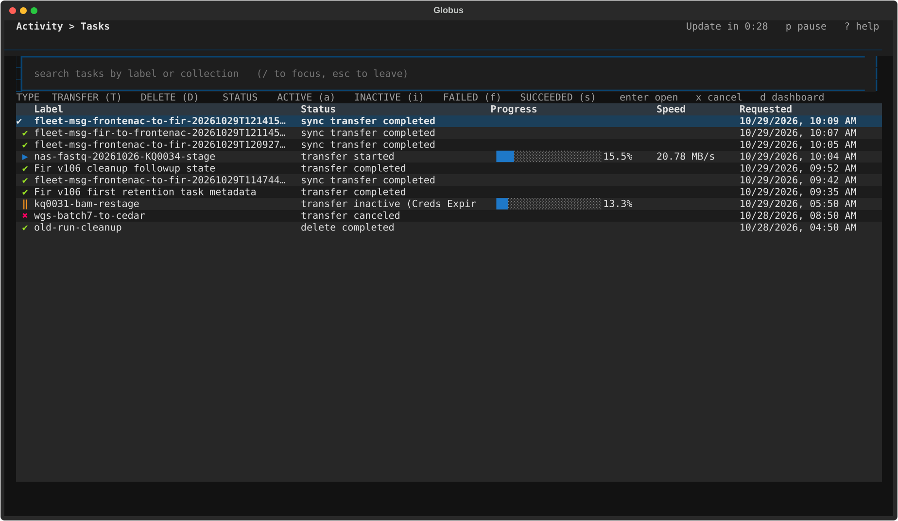
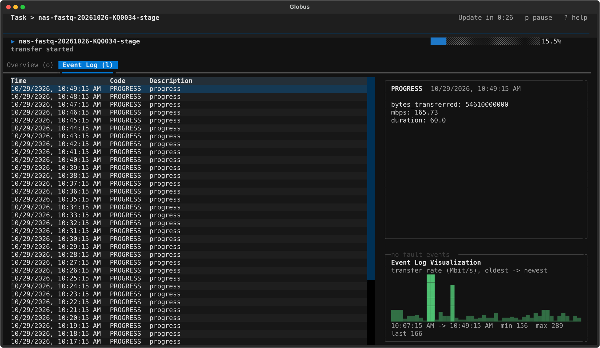

# globus-tui

A lightweight terminal UI for keeping an eye on Globus transfers without
leaving your shell. Press **Ctrl+G** in your terminal, see what is in flight,
press **q**, and you are back where you were.

It mirrors the three views of the Globus web app:

| Screen | What you see |
|---|---|
| **Dashboard** | Active / Failed / Succeeded counters (last 7 days), every active task with a progress bar, speed, bytes done / total, recent flow runs |
| **Activity › Tasks** | Searchable task list with TYPE and STATUS filters, status line per task ("sync transfer completed", "transfer started", …), progress for running tasks |
| **Task** | *Overview* tab with the same fields and stats box as the web app (files, directories, total estimated bytes, bytes transferred, effective speed …) and an *Event Log* tab with every event, its details, a fault-only toggle and a transfer-rate sparkline built from the PROGRESS events |

Auto-refresh with a visible "Update in m:ss" countdown, pause/resume, terminate
a task (with confirmation), edit a running task's label.

Built on [Textual](https://textual.textualize.io/) and the
[Globus SDK](https://globus-sdk-python.readthedocs.io/). Pure Python, no
daemon, no browser.





## Install (HPC login node, no root)

```bash
module load python/3.11      # if the cluster's default python is older than 3.9
git clone https://github.com/hamidghaedi/Terminal-UI-for-Globus.git ~/globus-tui
cd ~/globus-tui
./install.sh                 # private venv under ~/.local/share/globus-tui, command in ~/.local/bin
globus-tui --check           # uses an existing authenticated Globus CLI when available
globus-tui
```

`install.sh` creates its own venv (nothing touches the system or module
Python), symlinks `globus-tui` into `~/.local/bin`, and appends one commented
line to `~/.bashrc` (and `~/.zshrc` if present) that adds that directory to
PATH and binds **Ctrl+G**. Pass `--no-rc` to skip the rc edit, `--login` to
run the login at the end, or `PYTHON=/some/python3 ./install.sh` to choose the
interpreter.

Use `./install.sh --editable` during development so the installed command follows
changes in this checkout. The source can live on project storage while the private
environment and command stay in your home directory.

Run it on a login node; compute nodes usually have no route to the Globus
API. `globus-tui --check` prints a non-interactive environment report (Python,
encoding, TERM, tokens, API reachability) and is what to run when something
looks off. See `HANDOFF.md` for a step-by-step guide aimed at someone (or an
agent) installing it on a cluster for you.

Try it without an account first:

```bash
globus-tui --demo
```

### Login and tokens

The default `auto` backend uses an installed `globus` command and its existing
authenticated session. It does not copy credentials or request a second OAuth
grant. Run `globus login` yourself if that CLI session needs authentication.
Transfer task lists, exact counters, task details and event logs use the CLI's JSON
API interface. Flows are unavailable in this backend. `--logout` refuses to revoke
the CLI session because other tools may be using it.

If no CLI is installed, or with `--backend sdk`, the first run opens a standard Globus native-app login (a URL you open in any
browser, then paste the code back). Refresh tokens are stored by the SDK under
`~/.globus/app/`, so you only do this once. `globus-tui --backend sdk --logout` revokes and
deletes them.

By default the SDK's public tutorial client id is used. If you would rather
the tokens be issued to a client you own, register a *Native App* at
<https://app.globus.org/settings/developers> and either

```bash
export GLOBUS_TUI_CLIENT_ID=<your-uuid>
```

or put it in `~/.config/globus-tui/config.json`:

```json
{ "client_id": "<your-uuid>", "interval": 20, "flows": true }
```

## Hotkey

`shell/globus-tui.bash` binds, for interactive bash:

| Key | Opens |
|---|---|
| `Ctrl+G` | Dashboard |
| `Ctrl+X` `Ctrl+G` | Activity (task list) |

It uses `bind -x`, so whatever you had half-typed on the command line survives
the round trip. For zsh use `shell/globus-tui.zsh`; for tmux, the snippet in
`shell/tmux.conf` opens it as a popup over the current pane with `prefix g`.

If `Ctrl+G` is taken on your setup, change the key in the one `bind` line.

## Keys inside the TUI

```
Everywhere   d dashboard   t activity   r refresh   p pause   enter open   esc back   ? help   q quit
Activity     / search      T D  toggle TRANSFER / DELETE     a i f s  toggle ACTIVE / INACTIVE / FAILED / SUCCEEDED
             x terminate selected task
Task         o overview    l event log   F faults only   e edit label   x terminate
```

## Options

```
globus-tui [--demo] [--tasks] [--backend auto|cli|sdk] [-i SECONDS] [--client-id UUID] [--no-flows] [--login] [--logout] [--check]
```

`--no-flows` skips the Flows scope entirely if you never use flows and want a
smaller consent screen at login.

## Layout of the code

```
globus_tui/
  cli.py       argument parsing, --check / --login, launches the app
  backend.py   CLIBackend (existing CLI login), GlobusBackend (SDK login), DemoBackend
  fmt.py       byte / rate / date formatting and the web-app style status lines
  app.py       Textual screens: Dashboard, Tasks, TaskDetail, modals
  app.tcss     styling
shell/         bash, zsh and tmux bindings
install.sh     venv-based user-space installer for login nodes
HANDOFF.md     install guide for a person or agent setting this up on a cluster
```

The backend is a small interface (`list_tasks`, `count_tasks`, `get_task`,
`events`, `cancel`, `set_label`, `flow_runs`), so swapping in another data
source or adding screens (e.g. collections, timers) is straightforward.

## Notes

* If the terminal locale is not UTF-8 (common on clusters with `LANG=C`),
  the UI switches to ASCII glyphs; `export LANG=C.UTF-8` or set
  `GLOBUS_TUI_ASCII=1` to force either way.
* Task event history is kept by Globus for 30 days; older tasks show a
  "could not load events" entry in the Event Log, same as the web app.
* Total estimated bytes can grow while a task is still scanning directories,
  so the progress bar can move backwards early in a recursive transfer.
* Progress on the Dashboard and Activity screens is bytes-based when Globus
  has an estimate, and subtask-based otherwise (delete tasks, early scanning).

## Frontenac

The project checkout is at
`/global/project/hpcg6049/somatic_pipeline/Terminal-UI-for-Globus`.
Use `globus-tui --backend cli --check` to verify the current session, then
`globus-tui` or `globus-tui --tasks`. No Slurm allocation or separate native-app
login is needed. The app observes the account's transfers; existing pipeline,
fleet and archive controllers continue to own submissions and recovery.

For development checks: `python -m pip install -e '.[test]'`, then
`python -m pytest -q`. The tests use fake API responses and Textual's headless
terminal runner; they do not cancel or relabel live transfers.
